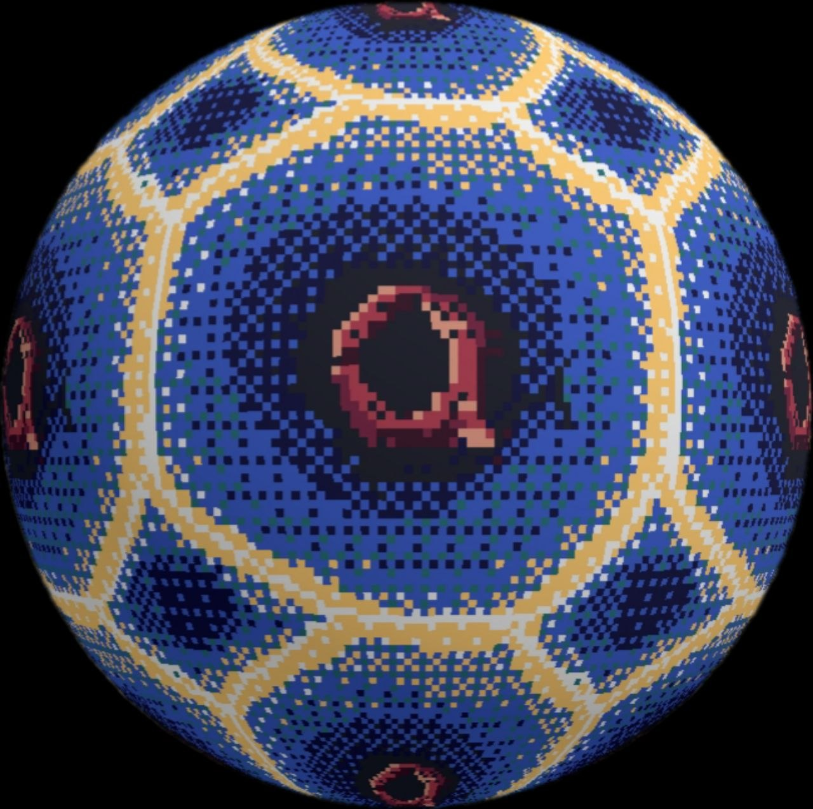

<p align="center"></p>

# qPainter

qPainter is a texture editor for **pixel art and painted textures**, with a **live 3D preview**. It's built for game and texture work: seamless tiling, limited palettes, dithering, symmetry, and checking the result on a cube, sphere, or your own model while you paint.

It runs in any modern browser, installs as an app (PWA), and ships as an **Android APK**. Everything runs locally and works offline.

---

## Contents

1. [Getting started](#getting-started)
2. [The interface](#the-interface)
3. [Basics: documents, navigation, colors](#basics)
4. [Tools](#tools)
5. [Pixel-art mixing and dithering](#pixel-art-mixing-and-dithering)
6. [Palette, lock and ramps](#palette-lock-and-ramps)
7. [Seamless textures (wrap mode)](#seamless-textures-wrap-mode)
8. [Symmetry](#symmetry)
9. [Selections](#selections)
10. [Layers](#layers)
11. [3D preview](#3d-preview)
12. [Files, export and autosave](#files-export-and-autosave)
13. [Shortcut and gesture reference](#shortcut-and-gesture-reference)
14. [Example workflows](#example-workflows)
15. [Troubleshooting](#troubleshooting)
16. [Development](#development)
17. [Limitations](#limitations)

---

## Getting started

### Run it on your computer

Requirements: [Node.js](https://nodejs.org) 20.19 or newer.

```sh
./start.sh          # dev server with hot reload, opens your browser
./start.sh prod     # production build + preview (offline support enabled)
```

The script installs dependencies on first run and serves on port 5173. It also prints a **Network** URL (like `http://192.168.1.20:5173/`); open that on a phone on the same Wi-Fi to try touch and stylus.

### Android app (APK)

Requirements: Android Studio (for its SDK and Java runtime).

```sh
./build-apk.sh           # builds qPainter.apk in the project folder
./build-apk.sh install   # builds and installs on a USB-connected phone (USB debugging on)
```

To install without a cable, copy `qPainter.apk` to the phone, open it, and allow "install unknown apps" when Android asks. The APK is debug-signed, which is fine for sideloading (see [Development](#development) for Play Store builds).

### Install as a web app (PWA)

Upload the `dist/` folder (from `npm run build`) to any HTTPS static host, such as GitHub Pages or Netlify. Open it in Chrome and choose **Install app** (desktop) or **Add to Home screen** (Android). After the first visit it works offline. Browsers only offer installation over HTTPS, so the LAN address from `start.sh` works for testing but can't be installed.

---

## The interface

```
┌──────────────────────────── top bar ─────────────────────────────┐
│ New Open Recent name Save Save-as Export ↶ ↷ │ Wrap Tiles Offset½ Symmetry │ Lock │ … ☰ │
├──────┬─────────────────────────────────────────┬─────────────────┤
│ tool │                                         │ Tool options    │
│ bar  │              canvas                     │ Palette         │
│      │                                         │ Layers          │
│      │                                         │ 3D preview      │
└──────┴─────────────────────────────────────────┴─────────────────┘
```

- **Top bar**: file actions, undo/redo, wrap, symmetry, palette lock, grids. On narrow screens it scrolls sideways.
- **Tool bar**: every tool, with its shortcut in the tooltip.
- **Side panel**: options for the current tool (only relevant controls are shown), then the palette, layers, and the 3D preview. **Tab** hides it on desktop.
- **Phone layout**: the tool bar moves to the bottom, and ☰ opens the side panel as an overlay. Close it with the **back** button or gesture, a **swipe right**, a **tap outside**, or **✕ Close**.

It follows your system's light or dark theme.

---

## Basics

### Documents

- **New…**: square sizes from 16 to 1024 px, or **W×H…** for any size up to 4096. The new texture keeps your current palette, ramps and settings. The texture you were working on is saved first (see [Files](#files-export-and-autosave)).
- **Open**: pick a PNG/JPG/WebP or a `.texproj.json` project in the system file dialog.
- **Recent**: every texture you've worked on, with thumbnails; click one to switch to it.
- **Save / Save as…**: write to a file you choose (details [below](#files-export-and-autosave)).
- **Export…**: a flattened PNG at 1×, 2×, 4×, 8× or 16×, scaled with hard pixel edges.
- The texture's **name** is shown in the top bar; click it to rename. A **•** after it means it has changes not yet written to its file.

### Navigating the canvas

| Action | Mouse / keyboard | Touch |
|---|---|---|
| Zoom | Mouse wheel / trackpad pinch, **+ / −** | Pinch |
| Pan | **Space**+drag, or middle-drag | Two-finger drag |
| Fit to screen | **0** or **Fit** | **Fit** |

Pixel grid lines appear automatically once you zoom in to 8× or more (**Grid** toggles them). **Tile grid** draws a guide every 4–64 px, handy for texture atlases.

### Colors

- Every tool paints with the **primary** color on left-click and the **secondary** color on right-click.
- The two color boxes at the top of the palette panel open the system color picker.
- **Pick a color**: click a swatch to make it primary; right-click (or long-press on touch) makes it secondary.
- **⇄** or **X** swaps the two colors.
- The small checkered strip next to them shows primary and secondary mixed in a 50% dither, so you can judge the blend before painting it.
- **Eyedropper**: press **I**, or hold **Alt** with any tool except Move. It samples the visible (flattened) image; right-click samples into the secondary color.

### Undo

**Ctrl+Z** / **Ctrl+Shift+Z** (or **Ctrl+Y**), or the ↶ ↷ buttons: 200 steps. One stroke, fill, or layer operation is one step.

---

## Tools

| Tool | Key | What it does | Options |
|---|---|---|---|
| ✏️ Pencil | P | Hard-edged pixels | Size, opacity, pressure → size / opacity, **pixel-perfect** |
| 🖌️ Brush | B | Soft round brush | Size, **hardness**, opacity, pressure |
| 🧽 Eraser | E | Erases to transparent (soft or hard) | Size, hardness, opacity, pressure |
| ▦ Dither | D | Paints a pattern of primary/secondary | Size, pattern, offset, density, pressure → size / density, 2nd color |
| ◐ Shade | H | Steps colors along a ramp | Size |
| ⁘ Noise | N | Random scatter of colors | Size, density, use ramp |
| ⇄ Replace | R | Recolors only one existing color | Size, tolerance |
| ≈ Smooth | A | Hand anti-aliasing helper | Size |
| ╱ Line | L | Straight line (**Shift** = snap to 0°/45°/90°) | Size, opacity |
| ▭ Rectangle | U | Outline or filled (**Shift** = square) | Size, opacity, filled |
| ◯ Ellipse | C | Outline or filled (**Shift** = circle) | Size, opacity, filled |
| 🪣 Fill | G | Flood fill | Opacity, tolerance, contiguous, fill with pattern |
| ▤ Gradient | J | Dithered gradient | Pattern, offset, radial, use ramp |
| 💧 Eyedropper | I / Alt | Pick a color | — |
| ⬚ Select | M | Rectangular selection | Selection actions |
| ✥ Move | V / O | Move a selection, or offset the layer | Selection actions |

Details:

- **Each tool remembers its own size**: brush starts at 8, eraser at 4, the others at 1. **[** and **]** change it (1–64).
- **Pixel-perfect** (pencil, size 1): removes the extra "elbow" pixel in diagonal strokes so lines stay one pixel wide.
- **Stylus pressure** only applies to pens. A mouse or finger always paints at full pressure.
- **Line / Rectangle / Ellipse** preview live while you drag and commit when you let go.
- **Fill** works on the current layer. **Tolerance** (0–255) sets how different a color can be and still get filled. **Contiguous** off fills every matching pixel in the layer. **Fill with pattern** fills using the current dither pattern.
- **Gradient**: drag from start to end. It goes from primary to secondary, or through the whole active ramp with **Use active ramp**. Right-drag reverses it. It's always dithered with the current pattern, so it only ever uses the palette colors it blends between.
- **Replace**: the color under the start of the stroke is the one that gets replaced; every other color is left alone. Useful for recoloring a single material.

---

## Pixel-art mixing and dithering

These tools blend colors the way pixel artists do, by arranging existing palette colors rather than inventing new ones.

### Dither brush and patterns

| Pattern | Look |
|---|---|
| Checker 50% | Classic alternating pixels |
| Bayer 2×2 / 4×4 / 8×8 | Ordered dither; **Density** controls how much primary shows (smooth 0–100% steps) |
| Lines — / Lines \| | Horizontal or vertical stripes |
| Diagonal | Diagonal stripes |
| Custom | Your own 8×8 pattern: click cells in the preview to toggle them |

- **Density** sets how much of the pattern is primary color. With **pressure → density**, pressing harder with a pen paints denser dither.
- **Paint 2nd color too**: off means only the primary pixels are painted, so the existing art shows through the gaps. On means the gaps get the secondary color.
- **Offset X / Offset Y** (0–7) shift the pattern. Use them to line a pattern up with pixels already on the canvas, or to do a second pass that fills exactly the gaps of the first. For example, a checker with Offset X = 1 is the exact inverse of the checker with 0.
- Patterns are anchored to the canvas, not the stroke, so overlapping strokes, symmetric copies and wrapped edges all line up. If a pattern's size doesn't divide the texture size in wrap mode, a ⚠ warning appears, because the pattern can't tile cleanly.

The same pattern, offset and density settings are used by **Fill with pattern** and the **Gradient** tool.

### Ramp shading

A **ramp** is an ordered row of colors from dark to light (see [ramps](#ramps)). The **Shade** brush moves each pixel it touches **one step lighter** along its ramp; right-click or **Shift** makes it one step darker. Each pixel changes at most once per stroke, so you build up shading with repeated strokes. Pixels whose color isn't in any ramp are left unchanged.

### Noise / scatter

Sprinkles random pixels at the chosen **density**, using primary and secondary, or random colors from the active ramp with **Use active ramp**. Each stroke uses a new random seed. Great for grain, dirt, gravel and stone.

### Smooth (hand anti-aliasing)

Replaces each pixel with the palette color closest to the average of itself and its four neighbours. Run it lightly along jagged edges or curves to get intermediate palette shades. It always uses palette colors.

### Soft brushes with a locked palette

With the palette [locked](#palette-lock), soft-brush blends are snapped back to palette colors, in one of two ways (set in the top bar):

- **snap nearest**: each blended pixel becomes the closest palette color. You get hard bands.
- **snap dither**: each blended pixel alternates between its two closest palette colors in a Bayer pattern. You get dithered gradients, as if you had dithered by hand.

---

## Palette, lock and ramps

### Palette

The default palette is **Sweetie 16**.

| Button | Action |
|---|---|
| **+** | Add the primary color to the palette |
| **−** | Remove the primary color from the palette |
| **Sort** | Sort swatches dark to light |
| **Import** | Load a `.gpl` (GIMP), `.hex` (Lospec) or text file, or an image (its colors, up to 256) |
| **.gpl / .hex** | Export the palette |
| **Extract** | Replace the palette with the image's colors, reduced to *N* colors (median cut) if there are more |
| **Remap…** | Convert the current layer to the palette: **nearest**, **ordered dither** (Bayer 4×4), or **Floyd–Steinberg** |

- **Drag a swatch** onto another to reorder the palette.
- The line under the palette shows how many colors the image uses, how many are in the palette, and how many pixels are **off-palette**. Use it to stay within your color budget.
- Palettes are a great fit for [Lospec](https://lospec.com/palette-list): download any palette as `.hex` and import it.

### Palette lock

**Lock** (top bar) restricts all painting to palette colors: any color a tool produces is snapped into the palette, and semi-transparent results become either fully opaque or fully transparent. Combine it with *snap dither* for dithered soft brushing (see [above](#soft-brushes-with-a-locked-palette)).

### Ramps

Ramps drive the **Shade** brush, **Noise** with *Use active ramp*, and **Gradient** with *Use active ramp*.

- **Hue-shift**: builds a ramp around the primary color. The first number sets how many steps on each side, the second the hue shift per step in degrees. Darker steps drift toward blue and lighter ones toward yellow, which is the usual pixel-art way to keep shading from looking flat.
- **Lerp**: builds a straight blend from primary to secondary, with 2 × *steps* + 1 colors.
- New ramp colors are added to the palette automatically.
- Click a ramp row to make it the **active ramp** (highlighted). **×** deletes it.

---

## Seamless textures (wrap mode)

Turn on **Wrap** (or press **W**) to paint tiling textures:

- Every tool wraps around the edges: brushes, lines, shapes, fills, dither patterns, moved selections, symmetry copies.
- **Tiles** shows the texture repeated 3×3 around the real one (the copies are dimmed), so you see seams while you paint.
- **Offset ½** shifts the current layer by half its width and height, bringing the edges into the middle so you can paint over the seam. Press it again to shift back. It's undoable.
- The **Move** tool with no selection drags the whole layer around freely, wrapping at the edges.
- **Remap → Floyd–Steinberg** in wrap mode carries the dithering error across the edges, so dithered results tile too.
- The 3D **wall** shape shows the texture tiled 3×3 in perspective.

---

## Symmetry

Choose a mode in the top bar, or press **S** to cycle through them:

| Mode | Copies |
|---|---|
| Mirror X | Left ↔ right |
| Mirror Y | Top ↔ bottom |
| Mirror XY | Four-way |
| Diagonal | Mirrored across the diagonal |
| Radial | 2–12 rotated copies (set the count in the number box) |

- The axes are drawn as dashed pink lines.
- **Ctrl/⌘+click** the canvas to move the symmetry center; it snaps to pixel edges and pixel centers. **⊕** resets it to the middle.
- Symmetry works with every painting tool, including fills and shapes, and combines with wrap mode. The Gradient tool ignores it.

---

## Selections

- **Select (M)**: drag a rectangle. **Ctrl+A** or **All** selects everything; **Esc** or **None** deselects.
- **While a selection exists, painting only affects the area inside it.** Deselect to paint everywhere again.
- **Move (V)**:
  - Drag inside the selection to pick up its pixels as a **floating selection**, which leaves a hole behind. Hold **Alt** when you start dragging to copy instead.
  - The floating pixels hover above the layer: you can drag them over other art repeatedly without damaging it.
  - **Enter** commits them. **Esc** cancels and puts everything back. Switching to another tool, undoing, or changing layers also commits.
  - Dragging outside the selection, or with no selection, moves the whole layer, wrapping at the edges.
- **Actions** (shown for Select and Move):

| Action | Shortcut | Notes |
|---|---|---|
| Copy / Cut | Ctrl+C / Ctrl+X | Copies the selection, or the whole layer if nothing is selected |
| Paste | Ctrl+V | Pastes as a floating selection at the selection's corner (or the top-left) and switches to Move. Images copied from other apps paste too. |
| Delete | Delete / Backspace | Clears the selection to transparent |
| Flip ↔ / Flip ↕ | — | Mirrors the selection, or the whole layer |
| Rotate ⟳ | — | 90° clockwise. The selection must be square, unless it's floating |

---

## Layers

- **+** new layer, **⧉** duplicate, **−** delete, **↑ ↓** reorder, **⤓** merge down.
- The checkbox toggles visibility. The slider on the active layer sets its opacity. Double-click a layer to rename it.
- Tools paint on the **active** (highlighted) layer. Fill, Replace and Remap look only at the active layer. The eyedropper and the 3D preview use all visible layers combined.
- All layer operations are undoable.

---

## 3D preview

The preview updates live as you paint. Drag to orbit, scroll or pinch to zoom.

| Control | Effect |
|---|---|
| Shape | cube, pyramid, sphere, cylinder, torus, plane, wall, or **custom** after loading a model |
| Repeat | Tiles the texture 1–4× across the surface |
| Nearest | Crisp pixels (off = smooth filtering, like a game's default) |
| Lit | Directional lighting (off = flat, unlit colors) |
| Spin | Auto-rotate |
| Color box | Background color |

Shape notes:

- The **cube** and the **pyramid** show the full texture on every face.
- The **sphere** repeats the texture twice around its equator, so pixels stay square.
- The **wall** is a large plane tiled 3×3: the easiest way to check seamless textures.

### Painting on the model

Tick **Paint** to draw directly on the 3D shape with the current tool:

- Left-drag (or one finger) paints. Right-drag (or two fingers) rotates the view.
- Strokes are mapped through the model's texture coordinates, so painting on a cube face paints the matching spot on the texture.
- Where a stroke crosses a texture seam on the model, it's split automatically instead of drawing a line across the texture.
- Brushes and dither work best here; shape and selection tools are meant for the flat canvas.

### Your own models

**Model…** loads a `.glb`, a single-file `.gltf` (embedded data), or an `.obj`. The model is centered and scaled to fit, and every mesh in it gets your texture. The model must have **UV coordinates**; otherwise it's rejected with a message. After loading, it's listed as **custom** in the shape menu.

---

## Files, export and autosave

### Save and Save as

- **Save** (Ctrl+S) the first time asks where to save with the system file dialog: Android's "Save to…" picker in the app, or a normal save dialog on desktop Chrome/Edge. The texture is then **linked** to that file, and every later **Save** overwrites it directly, without asking.
- **Save as…** always asks, and relinks the texture to the new file:
  - **Project…** (`.texproj.json`): all layers, palette, ramps and wrap/symmetry/lock settings.
  - **PNG (flattened)…**: the visible image. Later Saves keep writing the PNG, which is handy when a game project reads the texture directly. Layers aren't stored in a PNG, but the app keeps them in its Recent copy.
- **Opening** a PNG or project through **Open** links it too, so editing a PNG and pressing Save updates that PNG in place.
- **Export…** writes a PNG at 1×–16× to a location you pick, without changing the link. Use it for one-off scaled copies.
- Palette **.gpl / .hex** export also uses the save dialog.

In browsers without a save-file dialog (Firefox, Safari), Save and Export download the file instead, and the texture isn't linked.

### Recent textures and switching

- Everything you work on is kept in **Recent**, stored inside the app/browser, with a thumbnail, size, date, and whether it's linked to a file.
- Every change is autosaved to that copy about a second after you make it, so nothing is lost if the app closes.
- **Switching away** from a texture, whether with New, Open, or picking another one in Recent, first saves it: to Recent, and to its linked file if it has unsaved changes.
- Opening a file that's already in Recent reuses its entry instead of adding a duplicate.
- **×** removes an entry from Recent. The file on disk, if any, is kept. Blank textures that were never painted on or saved drop out of Recent automatically.
- On launch, the texture you had open last is restored.
- Tool options and the current colors aren't saved.

### Other files

| What | Where |
|---|---|
| **PNG export** | A single-layer texture at 1× exports its exact pixel values, including partial transparency. |
| **Palette files** | `.gpl` and `.hex`, import and export. |
| **3D models** | `.glb`, single-file `.gltf`, `.obj` via **Model…** (not stored in the project). |

---

## Shortcut and gesture reference

### Keyboard

| Key | Action | Key | Action |
|---|---|---|---|
| P | Pencil | G | Fill |
| B | Brush | J | Gradient |
| E | Eraser | I / hold Alt | Eyedropper |
| D | Dither | M | Select |
| H | Ramp shade | V / O | Move |
| N | Noise | L | Line |
| R | Replace color | U | Rectangle |
| A | Smooth | C | Ellipse |
| X | Swap colors | [ / ] | Brush size − / + |
| W | Toggle wrap | S | Cycle symmetry |
| 0 | Fit | + / − | Zoom in / out |
| Space+drag | Pan | Tab | Hide/show side panel |
| Ctrl+Z | Undo | Ctrl+Shift+Z / Ctrl+Y | Redo |
| Ctrl+C / X / V | Copy / cut / paste | Ctrl+A | Select all |
| Enter | Commit floating selection | Esc | Cancel float / deselect |
| Delete | Clear selection | Ctrl+S / Ctrl+Shift+S | Save / save as project |
| Ctrl+O | Open | | |

On macOS, ⌘ works wherever Ctrl is listed.

### Mouse and modifiers

| Input | Effect |
|---|---|
| Right button | Paint with secondary color. Eyedropper: pick into secondary. Shade: darken. Gradient: reversed. |
| Shift | Line: snap to 45°. Rectangle/ellipse: square/circle. Shade: darken. |
| Alt | Eyedropper while held. With Move: copy instead of cut. |
| Ctrl/⌘+click | Set symmetry center |
| Middle drag | Pan |
| Wheel | Zoom around the cursor |

### Touch and stylus

| Gesture | Effect |
|---|---|
| One finger / pen | Paint with the current tool |
| Two fingers | Pinch to zoom, drag to pan (cancels a stroke that was in progress) |
| Long-press a swatch | Set as secondary color |
| Pen pressure | Size, opacity or dither density, if enabled in tool options |
| Back / swipe right / tap outside | Close the side panel (phones) |

---

## Example workflows

### A seamless stone tile

1. **New… → 32**, turn on **Wrap**, set the 3D shape to **wall**.
2. Pick a mid-grey, click **Hue-shift** to make a 5-color ramp, and click it to make it active.
3. **Fill** the canvas with the middle color.
4. **Noise** tool with *Use active ramp* at about 30% density: scatter texture.
5. **Pencil** the cracks and stone outlines. Paint across the edges freely; the 3×3 tiles and the wall show the seams.
6. **Shade** brush: left-drag to light stone tops, Shift-drag to darken edges.
7. **Offset ½**, fix anything that looks off in the middle, and press **Offset ½** again.
8. **Export… → PNG 1×**.

### Recolor an existing texture to a fixed palette

1. **Open** the PNG.
2. **Import** the target palette (`.hex` from Lospec, or `.gpl`).
3. **Remap… → Floyd–Steinberg** for photos and gradients, **ordered dither** for a retro look, or **nearest** for flat art.
4. Turn on **Lock** so any touch-ups stay in the palette.

### Two-tone dither transition

1. **Dither** tool, pattern **Bayer 4×4**, **Paint 2nd color too** off.
2. Paint the transition zone at 25% density, then again at 25% with **Offset X = 1**. The second pass lands on a different set of dots, which together make a 50% band.
3. Or just use the **Gradient** tool from one color to the other.

### Paint a symmetrical emblem

1. Choose **Radial** and set 6 or 8 copies. Ctrl/⌘+click to place the center.
2. Paint one segment; the other copies appear as you draw.
3. Switch to **Mirror XY** for details that need a mirror image instead of rotation.

---

## Troubleshooting

| Problem | Fix |
|---|---|
| Painting does nothing | A selection is probably active: painting is limited to it. Press **Esc** to deselect. Also check that the active layer is visible. |
| Shade brush does nothing | The pixels' colors must be part of a ramp. Create one with **Hue-shift** or **Lerp**. |
| Colors change when I paint | **Lock** is on: colors are snapped into the palette. Add the color with **+**, or turn Lock off. |
| Dither looks broken at the seam | The texture size must be a multiple of the pattern size (watch for the ⚠ note). Use 2/4/8-px patterns on power-of-two textures. |
| Model won't load | It needs UV coordinates. `.gltf` files must be single-file (embedded); otherwise export as `.glb`. |
| "Install app" isn't offered | Installing requires HTTPS; the LAN address from `start.sh` is plain HTTP. Use the APK or host `dist/` on an HTTPS site. |
| APK build fails to find Java/SDK | Set `JAVA_HOME` and `ANDROID_HOME` before running `build-apk.sh`. |
| My previous texture is gone | Look in **Recent**. Recent lives in the app's/browser's storage: uninstalling the app or clearing site data removes it, so **Save** important work to files. |
| Save always asks where to save | The texture isn't linked to a file yet (or, in a browser without a save dialog, it can't be). After the first Save it's linked. |
| Chrome crashes when opening Recent in an Incognito window | A Chrome bug with remembered file links in temporary profiles; use a normal window. |

---

## Development

### Commands

```sh
npm install         # dependencies
npm run dev         # dev server (or ./start.sh)
npm test            # unit tests for the painting core (vitest)
npm run build       # typecheck + production build into dist/
./build-apk.sh      # Android APK via Capacitor
```

### Architecture

TypeScript + Vite, Canvas 2D for the editor, Three.js for the preview, Capacitor for Android. No UI framework: the interface is plain HTML in `index.html`, wired up in `main.ts`.

| File | Contents |
|---|---|
| `src/paint.ts` | Pure raster core with no DOM access: `plot()`, blending, palette snapping, dither patterns, shapes, flood fill, gradient, remap, palette extraction. |
| `src/doc.ts` | Document model: layers, undo/redo (dirty-rectangle diffs for strokes, snapshots for layer operations), compositing. |
| `src/tools.ts` | Tool implementations, tool options, floating selection, selection operations. |
| `src/view.ts` | Editor canvas: zoom/pan/pinch, pointer input, grids, tiling, symmetry and selection overlays. |
| `src/palette.ts` | Palette panel, `.gpl`/`.hex` parsing, hue-shift and lerp ramps, color statistics. |
| `src/preview3d.ts` | Three.js scene, shapes, texture sync, painting on the model via raycasting, model import. |
| `src/io.ts` | Save/open dialogs and linked files (File System Access API on desktop, the native plugin on Android), PNG/project encoding, the Recent library in IndexedDB. |
| `src/main.ts` | UI wiring, keyboard shortcuts, side panel behavior, app startup. |
| `public/` | PWA manifest, service worker, icons. |
| `android/` | Capacitor Android project: launcher icons, and `FilesPlugin.java`, a small native plugin for the system save/open picker (Storage Access Framework) with persistent access to picked files. |

**The key design rule:** every tool paints by calling `plot(ctx, x, y, coverage, fn)` in `paint.ts`. `plot` expands the point into its symmetric copies, wraps or clips it to the canvas, skips pixels outside the selection, calls `fn(currentColor, x, y, coverage)` to get the new color, and snaps the result into the palette if Lock is on. That's why wrap, symmetry, selections and palette lock work with every tool without any per-tool code.

### Adding a tool

1. In `makeTools()` (`src/tools.ts`), add an entry. Most brushes are just a pixel function:
   ```ts
   invert: brushTool(doc, { hard: true, mask: true, fn: () => (d) => [255 - d[0], 255 - d[1], 255 - d[2], d[3]] }),
   ```
   `mask: true` means each pixel is changed at most once per stroke.
2. Add `['invert', '◑', 'k', 'Invert']` to `TOOLS` in `src/main.ts` for its button and shortcut.
3. To show options for it, add the tool's id to the `data-for` attribute of the relevant controls in `index.html`.
4. If the logic is non-trivial, add a test to `src/paint.test.ts`.

### Release builds for the Play Store

The APK from `build-apk.sh` is debug-signed. For a store release, run `npx cap open android` and use **Build ▸ Generate Signed App Bundle** in Android Studio with your own signing key.

---

## Limitations

- Selections are rectangles only (no lasso or magic wand).
- One texture is open at a time (switch with Recent); there are no tabs.
- Tool options (other than brush size) are shared between tools and aren't saved between sessions.
- Undo stores a copy of the whole layer during each stroke, so very large textures (4K) use a lot of memory.
- Floyd–Steinberg tiles across the top/bottom edge using a warm-up heuristic, not an exact solution.
- No animation frames, normal-map generation, or texture-atlas management.
- iOS is untested (the web version will likely work in Safari; there's no iOS app build).
